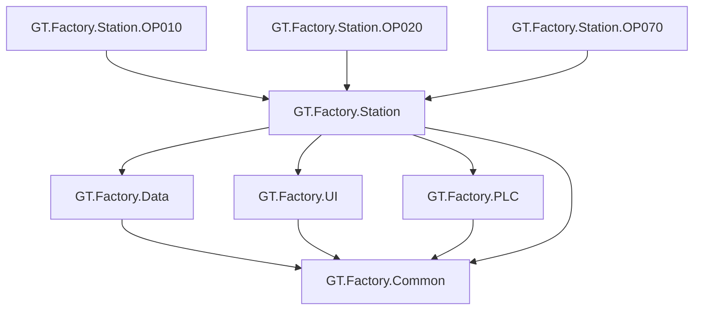

# GT.Factory

> 工业自动化软件基础平台与业务应用解决方案

GT.Factory 是面向工业自动化、产线测试、设备控制、数据采集、通讯调试及工程配置场景构建的一套 C# 软件体系。

项目并不是单一应用程序，而是由多个公共基础模块、数据模块、UI 模块、通讯模块以及具体工位业务程序组成。

当前项目正在从早期的：

```text
GT_Common
    ↓
各业务项目直接引用
```

逐步演进为：

```text
GT.Factory.Common
        ↓
GT.Factory.Data
        ↓
GT.Factory.UI
        ↓
各功能模块 / 业务项目
```

同时，LIN 相关功能已经逐步独立形成：

```text
GT.Factory.LIN
```

并建立了：

```text
LDF Parser
    ↓
LIN Model
    ↓
LIN Project
    ↓
LIN Runtime
    ↓
LIN Simulator
    ↓
LIN Project Debug
    ↓
LIN Test
```

的完整技术链路。

---

# 1. 项目定位

GT.Factory 的目标不是维护大量相互独立的工位程序，而是逐步建立一套可以复用的工业软件基础平台。

整体目标：

```text
┌───────────────────────────────────────────────┐
│                   GT.Factory                  │
├───────────────────────────────────────────────┤
│                                               │
│  Common        通用基础能力                   │
│  Data          数据访问与数据运行时           │
│  UI            通用界面组件                   │
│                                               │
│  PLC           PLC 通讯与设备控制             │
│  MES           MES / 后台交互                 │
│  LIN           LIN 协议 / Runtime / Debug    │
│                                               │
│  Station       具体工位业务                   │
│  Application   最终运行程序                  │
│                                               │
└───────────────────────────────────────────────┘
```

核心原则：

> **公共能力下沉，业务能力上移，具体工位只负责自己的业务逻辑。**

---

# 2. 当前整体架构

当前 GT.Factory 正处于从旧架构向模块化架构迁移的过程中。



整体关系可以理解为：

```text
                         GT.Factory
                              │
        ┌─────────────────────┼─────────────────────┐
        │                     │                     │
        ▼                     ▼                     ▼
GT.Factory.Common      GT.Factory.Data      GT.Factory.UI
        │                     │                     │
        └─────────────────────┼─────────────────────┘
                              │
              ┌───────────────┼────────────────┐
              │               │                │
              ▼               ▼                ▼
       GT.Factory.LIN    GT.Factory.PLC   GT.Factory.MES
              │
              ▼
       LIN Runtime / Debug
              │
              ▼
       Station / Business
              │
              ▼
          OPxxx
```

同时存在一部分历史代码：

```text
GT_Common
    │
    ├── 旧公共代码
    ├── 历史业务代码
    ├── 数据访问代码
    └── 部分业务依赖
```

这些代码不会一次性全部删除，而是根据实际业务情况逐步迁移。

---

# 3. 当前解决方案结构

当前解决方案中的项目大体可以分为以下几类：

```text
GT.Factory
│
├── GT.Factory.Common
│
├── GT.Factory.Data
│
├── GT.Factory.UI
│
├── GT.Factory.PLC
│
├── GT.Factory.MES
│
├── GT.Factory.LIN
│
├── GT_Common
│
└── 业务 / 工位项目
    ├── OPxxx
    ├── Station.xxx
    └── 其他业务程序
```

不同解决方案中具体项目数量可能有所变化，但总体架构遵循上述原则。

---

# 4. GT.Factory.Common

`GT.Factory.Common` 是新的公共基础层。

主要用于存放多个业务项目都需要使用的：

* Model
* Enum
* 基础工具
* 通用接口
* 通用配置
* 通用异常
* 基础类型
* 公共服务抽象

原则：

```text
GT.Factory.Common
        ↓
尽量保持稳定
        ↓
被多个模块复用
```

---

# 5. GT.Factory.Data

`GT.Factory.Data` 是当前数据库能力独立出来后的数据层。

之前大量数据库相关代码集中在历史项目中，例如：

```text
UploadSql
AccessMdbHelper
各种数据库操作
```

随着项目规模扩大，这种结构已经不适合继续发展。

因此逐步形成：

```text
GT.Factory.Data
│
├── Abstractions
│
├── Core
│
├── Providers
│
└── RepositoryContainer
```

---

# 6. Data 层核心结构

当前 Data 层主要思想：

```text
Application
     ↓
DataRuntime / DatabaseManager
     ↓
Database
     ↓
Repository
```

例如：

```text
DatabaseManager
      │
      ├── SQL Server
      │
      ├── SQLite
      │
      ├── Access
      │
      └── MySQL
```

通过统一抽象，使业务程序尽量不要直接依赖具体数据库实现。

---

# 7. GT.Factory.Data 的目标

Data 层最终承担：

* 数据库连接
* 数据库配置
* Repository
* 数据访问
* 本地缓存
* 同步队列
* 数据同步
* 数据库切换

例如：

```text
业务程序
   ↓
DataRuntime
   ↓
Repository
   ↓
SQL Server / SQLite / Access / MySQL
```

而不是：

```text
业务程序
   ↓
AccessMdbHelper
   ↓
SQL
```

---

# 8. 本地数据库与缓存

当前项目存在：

```text
Primary Database
        +
Local Cache
```

的设计。

例如：

```text
DatabaseOptions
│
├── Primary
│   └── SQL Server
│
└── LocalCache
    └── SQLite
```

本地 SQLite 可以承担：

* 本地历史数据
* 同步队列
* 离线缓存
* 临时数据

最终形成：

```text
Application
      ↓
DataRuntime
      ↓
┌───────────────┐
│ Primary       │
│ SQL Server    │
└───────────────┘
      +
┌───────────────┐
│ Local Cache   │
│ SQLite        │
└───────────────┘
```

---

# 9. GT.Factory.UI

`GT.Factory.UI` 用于承载多个工位程序共用的 UI 能力。

目标是逐步将历史项目中重复出现的：

```text
TitleUI
DataUI
StatusUI
ProductionInformationUI
WorkStatusUI
ConnectionStatus
```

等组件统一起来。

---

# 10. UI 层原则

UI 层负责：

```text
显示
交互
状态展示
通用控件
```

而不负责：

```text
数据库核心逻辑
PLC 通讯核心逻辑
MES 核心逻辑
LIN Runtime
具体工位业务
```

推荐：

```text
UI
 ↓
Service
 ↓
Runtime
 ↓
Infrastructure
```

而不是：

```text
Button_Click
 ↓
直接 SQL
 ↓
直接 PLC
 ↓
直接 MES
```

---

# 11. GT_Common

`GT_Common` 是项目历史发展过程中形成的公共代码集合。

它包含大量早期系统使用的：

* 公共类
* 数据库代码
* UI
* 工具
* 业务逻辑
* 配置
* 旧接口

目前仍然有部分业务程序依赖它。

因此：

> **GT_Common 当前不是立即删除，而是逐步迁移。**

---

# 12. GT_Common 迁移方向

长期目标：

```text
                    GT_Common
                       │
          ┌────────────┼────────────┐
          ▼            ▼            ▼
       Common         Data          UI
          │            │            │
          ▼            ▼            ▼
GT.Factory.Common GT.Factory.Data GT.Factory.UI
```

最终：

```text
旧项目
   ↓
逐步减少 GT_Common 依赖
   ↓
改用 GT.Factory.*
```

---

# 13. 为什么不能一次性迁移

GT_Common 中很多类已经被大量业务项目引用。

直接删除或大规模移动可能造成：

```text
类型引用错误
循环依赖
程序集引用错误
运行时异常
大量业务代码修改
```

因此采用：

> **渐进式迁移。**

原则：

```text
新功能
    ↓
优先使用 GT.Factory.*

旧功能
    ↓
根据修改机会逐步迁移
```

---

# 14. GT.Factory.LIN

LIN 是目前 GT.Factory 中一个已经开始独立形成完整架构的功能模块。

它的目标不是只做：

```text
LIN 报文收发
```

而是形成：

```text
LIN 协议解析
+
LIN 工程管理
+
LIN Runtime
+
LIN Simulator
+
LIN Debug
+
LIN Test
```

的完整基础平台。

---

# 15. GT.Factory.LIN 当前结构

当前 LIN 模块核心可以理解为：

```text
GT.Factory.LIN
│
├── Model
│
├── Parser
│
├── Project
│
├── Runtime
│
├── Simulator
│
├── ProjectDebug
│
└── Tests
```

---

# 16. LIN Model

Model 层定义 LIN 的核心对象：

```text
LinNetwork
LinNode
LinFrame
LinSignal
LinSchedule
```

关系：

```text
LinNetwork
│
├── LinNode
│
├── LinFrame
│   └── LinSignal
│
└── LinSchedule
```

Model 不应该依赖 UI。

---

# 17. LIN Parser

LIN Parser 用于解析 LDF 文件。

数据流：

```text
LDF
 ↓
Parser
 ↓
LinNetwork
```

Parser 的职责：

* LDF 文件读取
* LDF 语法解析
* Node 解析
* Frame 解析
* Signal 解析
* Schedule 解析
* Encoding 解析

Parser 不直接操作 WinForms。

---

# 18. LIN Project

Project 是对 LDF 的进一步工程化封装。

需要区分：

```text
LDF
```

和：

```text
Project JSON
```

LDF 描述：

> LIN 网络是什么。

Project JSON 描述：

> 当前这个调试项目如何使用这个 LIN 网络。

关系：

```text
LDF
 ↓
Parser
 ↓
Model
 ↓
Project JSON
```

---

# 19. LIN Runtime

Runtime 是 LIN 系统的运行核心。

主要负责：

* Runtime Session
* Frame Runtime
* Signal Runtime
* Signal Cache
* Schedule
* Trace
* Runtime 状态
* Frame 收发
* Signal 数据转换

整体：

```text
Project
   ↓
Runtime
   ↓
Frame
   ↓
Signal
```

Runtime 不应该直接依赖 UI 控件。

---

# 20. LIN Simulator

LIN Simulator 用于在没有真实 LIN 硬件的情况下运行 LIN 系统。

例如：

```text
Simulator
   ↓
Frame Send
   ↓
Frame Receive
   ↓
Signal Update
   ↓
Trace
```

这样可以在没有真实硬件的情况下完成：

* UI 开发
* Runtime 开发
* Parser 开发
* Signal 开发
* 自动化测试

---

# 21. LIN Hardware 抽象

未来接入真实 LIN 硬件时，不希望 Runtime 直接依赖某一个厂商 SDK。

推荐：

```text
ILinChannel
     │
 ┌───┴──────────────┐
 ▼                  ▼
Simulator         Hardware
                     │
             ┌───────┴───────┐
             ▼               ▼
         Vendor A        Vendor B
```

这样 Runtime 可以保持稳定。

---

# 22. LIN Project Debug

LIN Project Debug 是 LIN 项目的调试环境。

当前核心组件：

```text
LinDebugHost
    │
    └── LinDebugForm
            │
            ├── LinFrameTreeView
            ├── LinSignalPanel
            ├── LinTraceGrid
            └── LinStatusBar
```

---

# 23. LinDebugForm

调试主窗口负责：

* Project 打开
* Project 保存
* Runtime 控制
* Frame 浏览
* Signal 浏览
* Trace 查看
* Runtime 状态查看

推荐启动流程：

```text
Program
 ↓
LinDebugForm
 ↓
Open Project
 ↓
Project JSON
 ↓
Load LDF
 ↓
Create Runtime
 ↓
Start Debug
```

而不是继续依赖：

```text
Program
 ↓
硬编码 LDF
 ↓
直接启动 Debug
```

---

# 24. LinFrameTreeView

用于显示 Frame / Signal 层次：

```text
Frames
│
├── EngineStatus
│   ├── EngineSpeed
│   ├── EngineTemp
│   └── EngineState
│
├── VehicleStatus
│   ├── VehicleSpeed
│   └── VehicleState
│
└── BodyStatus
    ├── DoorStatus
    └── LightStatus
```

用户选择 Frame 后：

```text
Frame
 ↓
LinSignalPanel
```

---

# 25. LinSignalPanel

用于查看当前 Frame 的 Signal。

数据链：

```text
Signal
 ↓
LinSignalInfo
 ↓
LinSignal.ValueType
 ↓
UI
```

可以显示：

```text
Raw
Physical
Logical
Unit
```

例如：

```text
EngineSpeed

Raw:
1024

Physical:
1024 rpm

Logical:
Normal
```

---

# 26. LinTraceGrid

用于显示 LIN Trace：

```text
Time        ID      DLC      Data
------------------------------------------------
10:20:01    20      8        01 02 03 04 05 06 07 08
10:20:02    21      8        10 20 30 40 50 60 70 80
```

未来支持：

* Frame Filter
* ID Filter
* Clear
* Pause
* Auto Scroll
* Export
* Record
* Replay

---

# 27. LinStatusBar

用于显示：

```text
LIN
Runtime
Schedule
Hardware
Project
Error
```

等状态。

例如：

```text
LIN: Connected
Runtime: Running
Schedule: Running
Hardware: Online
```

---

# 28. LIN 全链路

当前 LIN 最重要的技术链路：

```text
                  LDF
                   │
                   ▼
              LIN Parser
                   │
                   ▼
               LIN Model
                   │
                   ▼
             Project JSON
                   │
                   ▼
              LIN Runtime
                   │
          ┌────────┴────────┐
          ▼                 ▼
     Simulator          Hardware
          │                 │
          └────────┬────────┘
                   ▼
              Trace / Signal
                   │
                   ▼
             Project Debug
                   │
          ┌────────┼────────┐
          ▼        ▼        ▼
       Frame    Signal    Status
```

---

# 29. LIN-RUNTIME-ISSUE-001

当前 LIN Runtime 有一个已经明确记录的后续架构问题：

## Signal Cache 数据类型

历史实现：

```csharp
Dictionary<string, double>
```

这种方式无法完整表达：

```text
bool
enum
int
uint
float
double
string
```

等不同 Signal 类型。

因此后续需要演进为：

```text
Raw Value
     ↓
Typed Value
     ↓
Signal Conversion
     ↓
Physical Value
     ↓
Logical Value
```

该问题：

> **已经记录为计划中的 Runtime 架构修改，目前不作为立即修改项。**

---

# 30. LIN Test

LIN Test 不仅测试单个 Class，还应该验证完整链路。

例如：

```text
LDF
 ↓
Parser
 ↓
Model
 ↓
Project
 ↓
Runtime
 ↓
Simulator
 ↓
Frame
 ↓
Signal
 ↓
Trace
```

因此测试结构可以包括：

```text
Tests
│
├── Parser
├── Model
├── Project
├── Runtime
└── ProjectDebug
```

其中 `ProjectDebug` 负责验证全链路。

---

# 31. 业务项目

GT.Factory 最终仍然需要服务具体工位。

例如：

```text
OP070
OPxxx
Station.xxx
```

这些项目不应该重新实现：

```text
数据库
UI 基础控件
LIN Parser
LIN Runtime
通用工具
```

而应该：

```text
业务项目
   ↓
GT.Factory.Common
GT.Factory.Data
GT.Factory.UI
GT.Factory.PLC
GT.Factory.MES
GT.Factory.LIN
```

---

# 32. 工位程序的职责

一个具体工位程序应该主要负责：

```text
产品流程
工艺流程
工位逻辑
设备动作
业务规则
测试流程
MES 业务
```

而不是承担所有基础设施。

理想状态：

```text
Station.OP070
      │
      ├── Process
      ├── Workflow
      └── Station Logic
              │
              ▼
       GT.Factory.*
```

---

# 33. 公共 Runtime 思路

随着项目规模扩大，越来越多程序需要共享运行时对象。

例如：

```text
AppRuntime
DataRuntime
PLC Runtime
LIN Runtime
MES Runtime
```

目标是避免：

```csharp
new Runtime()
new Runtime()
new Runtime()
```

导致多个运行时实例。

而应该在应用启动时建立：

```text
Application
    ↓
Runtime
    ├── Data
    ├── PLC
    ├── MES
    └── LIN
```

业务模块通过依赖关系获得对应 Runtime。

---

# 34. 依赖方向

总体原则：

```text
基础层
   ↓
基础设施
   ↓
功能模块
   ↓
业务模块
```

推荐：

```text
GT.Factory.Common
        ↓
GT.Factory.Data
        ↓
GT.Factory.UI
        ↓
GT.Factory.PLC / MES / LIN
        ↓
Station / OPxxx
```

具体项目可以根据实际依赖做调整，但应避免形成循环引用。

---

# 35. 禁止形成的依赖

不推荐：

```text
Common
  ↑    ↓
Data ← UI
```

或者：

```text
LIN
 ↓
Station
 ↓
LIN
```

形成：

```text
A → B → C → A
```

的循环依赖。

---

# 36. 新功能开发原则

以后新增功能时，优先判断它属于哪一层。

### 如果是公共类型

放：

```text
GT.Factory.Common
```

### 如果是数据库能力

放：

```text
GT.Factory.Data
```

### 如果是通用 UI

放：

```text
GT.Factory.UI
```

### 如果是 LIN 能力

放：

```text
GT.Factory.LIN
```

### 如果是 PLC 通讯

放：

```text
GT.Factory.PLC
```

### 如果是 MES 能力

放：

```text
GT.Factory.MES
```

### 如果是具体工位业务

放：

```text
Station / OPxxx
```

---

# 37. 不要继续扩大 GT_Common

当前最重要的一条开发约定：

> **新的公共功能不要继续往 `GT_Common` 中堆。**

新代码优先进入：

```text
GT.Factory.Common
GT.Factory.Data
GT.Factory.UI
```

或对应专业模块。

`GT_Common` 主要用于：

```text
兼容旧系统
承载尚未迁移代码
逐步迁移
```

---

# 38. 当前迁移策略

采用：

```text
旧代码
 ↓
识别职责
 ↓
确定目标模块
 ↓
新模块实现
 ↓
旧项目切换引用
 ↓
验证
 ↓
删除旧实现
```

例如：

```text
UploadSql
 ↓
数据库职责分析
 ↓
GT.Factory.Data
 ↓
Repository / Service
 ↓
业务项目逐步切换
```

而不是：

```text
直接删除 UploadSql
```

---

# 39. 当前开发阶段

目前项目属于：

> **基础架构持续重构 + 新功能模块化建设阶段**

重点工作不是简单增加功能，而是解决：

```text
代码复用
项目依赖
公共模块
Runtime
数据访问
LIN 架构
业务解耦
```

等长期问题。

---

# 40. 当前重点任务

## GT.Factory.Common

* [ ] 持续整理公共 Model
* [ ] 整理 Enum
* [ ] 整理公共接口
* [ ] 减少 GT_Common 新代码

## GT.Factory.Data

* [ ] 完善 DataRuntime
* [ ] 完善 DatabaseManager
* [ ] 完善 Repository
* [ ] 完善 SQLite Local Cache
* [ ] 逐步迁移旧数据库代码
* [ ] 逐步替代 UploadSql

## GT.Factory.UI

* [ ] 公共控件整理
* [ ] 统一 UI 风格
* [ ] 减少业务项目重复 UI
* [ ] 公共状态组件

## GT.Factory.LIN

* [ ] LDF Parser
* [ ] Project JSON
* [ ] Runtime
* [ ] Simulator
* [ ] Project Debug
* [ ] Trace
* [ ] Signal Conversion
* [ ] Hardware Abstraction
* [ ] Test

## GT_Common

* [ ] 梳理现有依赖
* [ ] 确定迁移目标
* [ ] 新代码禁止继续堆积
* [ ] 按模块逐步迁移

---

# 41. LIN 后续规划

LIN 最终目标：

```text
GT.Factory.LIN
│
├── Parser
│
├── Model
│
├── Project
│
├── Runtime
│
├── Simulator
│
├── Hardware
│
├── Debug
│
└── Test
```

后续可以继续增加：

* Schedule Engine
* LIN Diagnostic
* Transport Layer
* Node Configuration
* Frame Replay
* Trace Record
* Signal Graph
* 自动化测试
* Script
* Hardware Plugin
* 多 LIN Channel
* 多厂商硬件

---

# 42. GT.Factory 最终目标

GT.Factory 最终希望形成：

```text
                         GT.Factory
                              │
        ┌─────────────────────┼─────────────────────┐
        │                     │                     │
        ▼                     ▼                     ▼
      Common                Data                   UI
        │                     │                     │
        └─────────────────────┼─────────────────────┘
                              │
       ┌──────────────────────┼──────────────────────┐
       │                      │                      │
       ▼                      ▼                      ▼
      PLC                    MES                    LIN
       │                      │                      │
       │                      │              ┌───────┴────────┐
       │                      │              │                │
       │                      │           Runtime         Simulator
       │                      │              │
       └──────────────┬───────┴──────────────┘
                      │
                      ▼
                 Station / OP
                      │
                      ▼
                  Production
```

最终形成一个：

> **可复用、可扩展、可维护的工业自动化软件基础平台。**

---

# 43. 开发原则总结

GT.Factory 后续开发遵循以下原则：

### 1. 新代码模块化

不要继续把所有东西放进一个公共项目。

### 2. 公共能力下沉

公共能力进入：

```text
GT.Factory.Common
GT.Factory.Data
GT.Factory.UI
```

### 3. 专业能力独立

例如：

```text
LIN → GT.Factory.LIN
PLC → GT.Factory.PLC
MES → GT.Factory.MES
```

### 4. 业务逻辑上移

具体工位只负责：

```text
工艺
流程
业务
```

### 5. Runtime 与 UI 解耦

UI 不直接承担通讯和数据核心逻辑。

### 6. Hardware 与 Runtime 解耦

硬件通过接口接入。

### 7. 旧代码渐进迁移

不为了“架构漂亮”而一次性破坏现有业务。

### 8. 新架构优先服务未来

每次新增功能都应该考虑：

```text
这个代码以后其他项目能不能复用？
```

---

# 44. 当前项目状态

当前 GT.Factory 已经从早期的：

```text
一个大型公共项目
+
多个业务程序
```

开始向：

```text
基础平台
+
专业功能模块
+
业务应用
```

方向演进。

目前最明显的两个架构建设方向：

```text
GT.Factory.*
```

公共基础平台化，以及：

```text
GT.Factory.LIN
```

专业通讯调试平台化。

---

# 45. 一句话理解 GT.Factory

如果需要用一句话理解当前项目：

> **GT.Factory 是一个面向工业自动化场景，将公共基础能力、数据访问、UI、PLC、MES、LIN 通讯以及具体工位业务逐步模块化的平台型 C# 软件体系。**

其中：

```text
GT.Factory.Common
        ↓
基础能力

GT.Factory.Data
        ↓
数据能力

GT.Factory.UI
        ↓
界面能力

GT.Factory.LIN
        ↓
LIN 专业能力

GT.Factory.PLC
        ↓
PLC 专业能力

GT.Factory.MES
        ↓
MES 专业能力

Station / OPxxx
        ↓
具体业务
```

这就是当前 GT.Factory 的整体架构方向。

---

# 46. Repository 使用说明

开发人员进入项目后，建议首先阅读：

```text
README.md
```

然后根据开发内容进入对应模块：

```text
公共功能
→ GT.Factory.Common

数据库
→ GT.Factory.Data

公共 UI
→ GT.Factory.UI

LIN
→ GT.Factory.LIN

PLC
→ GT.Factory.PLC

MES
→ GT.Factory.MES

具体工位
→ Station / OPxxx
```

---

# 47. 最终架构愿景

最终希望将整个体系稳定在：

```text
┌──────────────────────────────────────────────────┐
│                   GT.Factory                    │
│                                                  │
│  ┌──────────┐ ┌──────────┐ ┌──────────┐         │
│  │  Common  │ │   Data   │ │    UI    │         │
│  └────┬─────┘ └────┬─────┘ └────┬─────┘         │
│       │             │             │              │
│       └─────────────┼─────────────┘              │
│                     │                            │
│       ┌─────────────┼─────────────┐              │
│       │             │             │              │
│       ▼             ▼             ▼              │
│      PLC            MES           LIN            │
│                                  │               │
│                         ┌────────┼────────┐      │
│                         ▼        ▼        ▼      │
│                      Parser   Runtime  Simulator │
│                                  │               │
│                                  ▼               │
│                               Debug              │
│                                  │               │
│                                  ▼               │
│                         Automation Test          │
│                                                  │
└───────────────────────┬──────────────────────────┘
                        │
                        ▼
                Station / OPxxx
                        │
                        ▼
                   Production
```

**GT.Factory 的核心方向：**

```text
平台化
模块化
复用化
解耦化
可扩展
可维护
```

而不是继续让所有功能不断堆积到 `GT_Common` 中。
