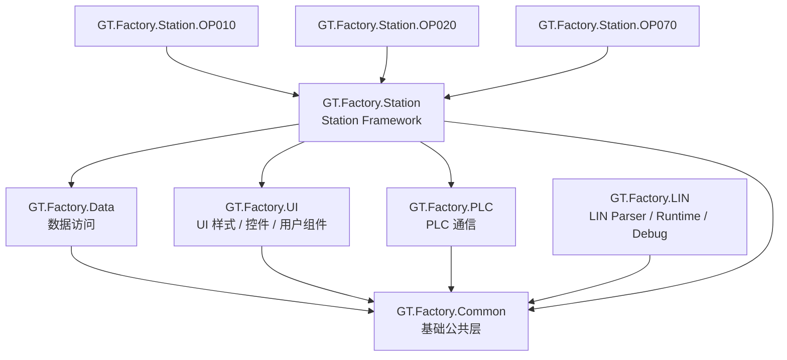
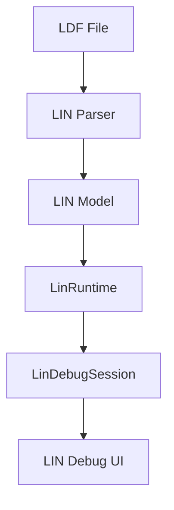
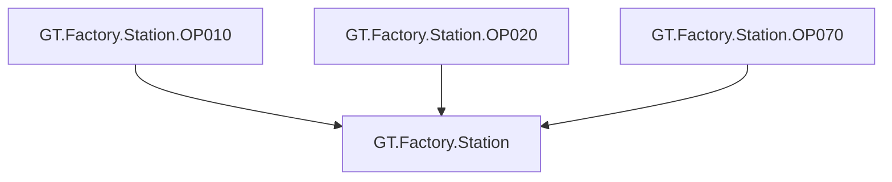

# GT.Factory

> 盖特龙工业自动化软件基础框架与 Station 应用平台

GT.Factory 是面向工业自动化、产线测试及设备控制场景构建的 C# 软件基础平台。

项目采用模块化架构，将公共基础能力、数据访问、UI、PLC 通信、LIN 通信以及 Station 工位应用进行分层管理。

---

# 一、项目定位

GT.Factory 的目标不是构建一个单一应用，而是建立一套可持续扩展的工业软件基础框架。

主要解决：

- 工业自动化 Station 应用开发
- PLC 通信
- 数据访问
- 通用 UI 控件及样式
- 工艺流程配置
- LIN 总线解析与调试
- 多工位程序复用
- Station 快速开发
- 公共基础能力复用

整体设计目标：

> **公共能力统一、业务能力隔离、Station 独立、功能模块可扩展。**

---

# 二、当前整体架构



> 注：图中的箭头表示项目依赖关系。

---

# 三、项目结构

```text
GT.Factory
│
├── GT.Factory.Common
│
├── GT.Factory.Data
│
├── GT.Factory.UI
│
├── GT.Factory.PLC
│
├── GT.Factory.LIN
│
├── GT.Factory.Station
│
├── GT.Factory.Station.OP010
├── GT.Factory.Station.OP020
├── GT.Factory.Station.OP070
│
└── ...
```

---

# 四、各项目职责

## 4.1 GT.Factory.Common

最底层公共基础层。

主要用于存放真正跨业务、跨模块的基础能力。

例如：

```text
GT.Factory.Common
├── 基础 Model
├── 基础工具
├── 通用 Helper
├── 基础接口
└── 公共定义
```

### 设计原则

`GT.Factory.Common` 应保持：

- 小
- 稳定
- 低依赖
- 不包含具体业务
- 不依赖 Station
- 不依赖具体工艺

避免再次形成过去 `GT_Common` 那种“大杂烩项目”。

---

# 五、GT.Factory.Data

数据访问基础设施。

主要负责：

```text
数据库连接
数据库 Provider
Repository
数据访问
本地缓存
数据库运行时
```

典型结构：

```text
GT.Factory.Data
│
├── Abstractions
│
├── Core
│
├── Providers
│   ├── Access
│   ├── SQLite
│   ├── MySQL
│   └── SQL Server
│
└── Repository
```

### 设计目标

将数据库访问从 Station 和业务代码中独立出来。

业务代码不应该直接依赖具体数据库实现。

---

# 六、GT.Factory.UI

GT.Factory.UI 是项目统一的 UI 基础库。

主要负责：

```text
样式
通用控件
用户控件
UI Component
主题
UI 辅助组件
```

例如：

```text
GT.Factory.UI
│
├── Styles
├── Controls
├── UserControls
├── Components
└── ...
```

### 注意

`GT.Factory.UI` **不是所有 Form 的存放位置**。

应当区分：

### 通用 UI

放：

```text
GT.Factory.UI
```

例如：

- 通用 DataGridView
- 通用状态栏
- 通用标题控件
- 通用按钮
- 通用用户控件
- 通用 UI 样式

### Station 业务 Form

放：

```text
GT.Factory.Station
```

或者：

```text
GT.Factory.Station.OP010
```

例如：

```text
OP070MainForm
ProcessConfigForm
StationSettingForm
```

如果这些 Form 具有明显的 Station / 工艺业务属性，就不应该为了“统一”全部放进 `GT.Factory.UI`。

---

# 七、GT.Factory.PLC

PLC 通信基础设施。

当前主要从原有 `PlcComm` 中拆分出来。

```text
GT.Factory.PLC
│
└── PlcComm
    ├── PLC Connection
    ├── Read
    ├── Write
    ├── Siemens
    └── ...
```

### GT.Factory.PLC 负责

> **如何与 PLC 通信。**

例如：

```text
Connect
Disconnect
Read
Write
PLC Driver
PLC Communication
```

### GT.Factory.PLC 不负责

不负责具体工艺：

```text
StandardProcess
CalibrationProcess
BarBindProcess
PeriodProcess
```

这些属于 Station / Process 业务层。

---

# 八、GT.Factory.LIN

LIN 总线相关完整功能模块。

当前包含：

```text
LIN Parser
LIN Model
LIN Runtime
LIN Simulator
LIN Debug
LIN Test
```

整体结构：



当前主要组件包括：

```text
LinNetwork
LinNode
LinFrame
LinSignal
LinSchedule
LinRuntime
LinController
LinEngine
LinDebugSession
LinDebugForm
LinDebugHost
LinFrameTreeView
LinSignalPanel
LinStatusBar
LinTraceGrid
```

### 设计原则

LIN Runtime 不直接负责 UI。

UI：

```text
UI
 ↓
LinDebugSession
 ↓
LinRuntime
 ↓
Frame / Signal
```

`LinDebugSession` 作为 Runtime 与 UI / Test / Station 之间的桥梁。

---

# 九、GT.Factory.Station

这是当前架构中非常重要的一层。

`GT.Factory.Station` 是：

> **Station Framework**

它由原来的 `GT_Common` 演变而来。

---

## 9.1 Station Framework 的职责

主要提供所有 Station 共用的基础能力。

例如：

```text
BaseMainForm
ControlEngineBase
Station Runtime
ProcessConfig
Station Models
Station Forms
Station Helpers
公共工艺能力
```

---

## 9.2 为什么不是直接把 GT_Common 改名就结束

过去的：

```text
GT_Common
```

包含了大量：

```text
Model
Helper
Form
ProcessConfig
BaseMainForm
ControlEngineBase
...
```

其中很多实际上都是：

> **Station 专属基础能力**

因此当前架构将其定位为：

```text
GT.Factory.Station
```

而不是继续使用：

```text
GT_Common
```

---

# 十、ProcessConfig 的定位

当前 PLC 相关代码主要拆出了：

```text
PlcComm
```

进入：

```text
GT.Factory.PLC
```

但是：

```text
ProcessConfig
```

暂时保留在：

```text
GT.Factory.Station
```

这是有意的。

因为：

```text
GT.Factory.PLC
```

解决：

> 怎么与 PLC 通信。

而：

```text
ProcessConfig
```

解决：

> 当前工位的工艺需要读取哪些 PLC 数据，以及这些数据如何参与工艺。

例如：

```text
StandardProcess
CalibrationProcess
BarBindProcess
PeriodProcess
PlcReadConfig
PlcMeasureGroup
```

因此两者职责不同。

---

# 十一、Station 项目

每一个具体工位都是独立项目。

当前命名规范：

```text
GT.Factory.Station.OP010
GT.Factory.Station.OP020
GT.Factory.Station.OP070
```

结构：



---

# 十二、Station 的设计目标

Station 项目应该尽可能保持简单。

例如：

```text
GT.Factory.Station.OP070
│
├── MainForm
├── ControlEngine
├── OP070 Process
├── OP070 Config
└── OP070 Specific Code
```

公共能力全部由：

```text
GT.Factory.Station
```

提供。

因此最终希望形成：

```text
                    GT.Factory.Station
                           ▲
             ┌─────────────┼─────────────┐
             │             │             │
           OP010         OP020         OP070
```

而不是每个 Station 都重复实现：

```text
BaseMainForm
ControlEngineBase
ProcessConfig
数据库
UI 控件
PLC 通信
...
```

---

# 十三、Station 依赖原则

具体 Station：

```text
GT.Factory.Station.OPxxx
```

可以依赖：

```text
GT.Factory.Station
```

而：

```text
GT.Factory.Station
```

**不能反向依赖：**

```text
GT.Factory.Station.OP010
GT.Factory.Station.OP020
GT.Factory.Station.OP070
```

也就是说：

```text
OP010
  ↓
Station
```

不能：

```text
Station
  ↓
OP010
```

---

# 十四、架构依赖原则

总体遵循：

```text
具体业务
    ↓
Station Framework
    ↓
基础设施
    ↓
Common
```

避免：

```text
Common → Station
Common → OPxxx

Station → OPxxx

OP010 → OP020
OP020 → OP070
```

具体 Station 之间原则上互不依赖。

---

# 十五、Model 的放置原则

Model 不按照“所有 Model 放一个项目”的方式处理。

而是按照：

> **谁拥有这个 Model，谁负责它。**

例如：

### 全局基础 Model

```text
GT.Factory.Common
```

### 数据访问相关 Model

```text
GT.Factory.Data
```

### UI 专属 Model

```text
GT.Factory.UI
```

### Station 公共 Model

```text
GT.Factory.Station
```

### OP010 专属 Model

```text
GT.Factory.Station.OP010
```

这样可以减少不必要的项目引用。

---

# 十六、为什么不把所有 Model 放到 Common

不建议：

```text
GT.Factory.Common
└── Models
    ├── PLC Model
    ├── Station Model
    ├── UI Model
    ├── MES Model
    ├── Process Model
    └── OP010 Model
```

因为这样会导致：

```text
Common
   ↓
越来越大
   ↓
越来越多业务
   ↓
所有项目都依赖 Common
```

最终重新形成过去：

```text
GT_Common
```

的问题。

---

# 十七、旧 GT_Common 的处理策略

当前不采用一次性全部拆解。

原则：

> **先稳定架构，再逐步迁移。**

原 `GT_Common` 中的内容根据职责逐步迁移：

```text
GT_Common
│
├── PlcComm
│      ↓
│   GT.Factory.PLC
│
├── UI 通用控件
│      ↓
│   GT.Factory.UI
│
├── 数据访问
│      ↓
│   GT.Factory.Data
│
├── Station Framework
│      ↓
│   GT.Factory.Station
│
└── 真正基础公共能力
       ↓
    GT.Factory.Common
```

不是所有代码都应该进入 `Common`。

---

# 十八、当前架构原则

当前版本遵循以下原则：

### 原则 1：Common 保持小

```text
Common = 基础能力
```

不是：

```text
Common = 所有公共代码
```

---

### 原则 2：按职责拆分

```text
Data → 数据
UI → UI
PLC → PLC
LIN → LIN
Station → Station
Common → 基础
```

---

### 原则 3：Station 独立

每个：

```text
GT.Factory.Station.OPxxx
```

都是独立项目。

---

### 原则 4：公共能力下沉

多个 Station 都需要的能力：

```text
→ GT.Factory.Station
```

多个业务模块都需要的真正基础能力：

```text
→ GT.Factory.Common
```

---

### 原则 5：不要过度拆分

当前不会为了“看起来分层”而创建大量项目。

只有当职责、依赖边界和复用需求真正明确时，才进行进一步拆分。

---

# 十九、当前技术栈

主要技术：

```text
C#
WinForms
.NET Framework
Visual Studio
Git
Newtonsoft.Json
HslCommunication
```

根据具体模块使用：

```text
SQL Server
MySQL
SQLite
Access
Siemens PLC
LIN
```

---

# 二十、Git 工作方式

建议保持：

```text
main
```

作为稳定主分支。

开发过程中：

```text
修改
 ↓
Build
 ↓
测试
 ↓
git status
 ↓
git add -A
 ↓
git commit
 ↓
git push
```

提交示例：

```bash
git add -A

git commit -m "refactor: reorganize GT.Factory architecture"

git push origin main
```

---

# 二十一、项目开发原则

GT.Factory 后续开发优先遵循：

1. 优先复用已有基础能力
2. 避免重复实现
3. 避免循环依赖
4. 避免 Common 无限膨胀
5. Station 保持业务独立
6. 通用 UI 进入 GT.Factory.UI
7. PLC 通信进入 GT.Factory.PLC
8. 数据访问进入 GT.Factory.Data
9. LIN 功能进入 GT.Factory.LIN
10. Station 公共能力进入 GT.Factory.Station
11. 不为了拆项目而拆项目
12. 架构调整必须考虑已有 Station 的迁移成本

---

# 二十二、当前架构基线

当前架构版本：

```text
GT.Factory Architecture Baseline V1
```

核心结构：

```text
GT.Factory.Common
        ↑
        │
 ┌──────┼──────┐
 │      │      │
Data    UI     PLC
        │      │
        └──┬───┘
           │
           ↓
GT.Factory.Station
           ↑
     ┌─────┼─────┐
     │     │     │
   OP010 OP020 OP070
```

当前原则：

> **先稳定职责边界，再进行渐进式迁移。**

---

# 二十三、后续规划

后续根据实际项目发展逐步完善：

```text
GT.Factory
│
├── Common
├── Data
├── UI
├── PLC
├── LIN
├── Station
│
└── Station.OPxxx
```

可能进一步增加：

```text
MES
Equipment
Recipe
Process
Communication
Logging
```

但只有在实际出现明确职责边界和复用需求时才进行拆分。

---

# 二十四、文档

建议后续逐步建立：

```text
docs/
│
├── architecture/
│   ├── architecture.md
│   ├── station.md
│   ├── data.md
│   ├── ui.md
│   ├── plc.md
│   └── lin.md
│
├── development/
│
└── migration/
```

README 负责：

> **整体介绍和架构入口。**

详细设计放到 `docs/` 中。

---

# 二十五、总结

GT.Factory 当前不是一个单一业务项目，而是一套工业软件基础平台。

核心思想：

```text
                     GT.Factory
                          │
        ┌─────────────────┼─────────────────┐
        │                 │                 │
     基础能力           基础设施          Station
        │                 │                 │
     Common       Data / UI / PLC       OPxxx
                                     
                          +
                         
                    GT.Factory.LIN
```

最终目标：

> **让新的 Station 不需要重新建设基础框架，只需要关注自己的业务流程。**

即：

```text
新建 Station
     ↓
引用 GT.Factory.Station
     ↓
复用基础能力
     ↓
实现自己的业务
     ↓
形成独立 Station
```

---

**GT.Factory Architecture Baseline V1**

持续演进，但不轻易破坏已经稳定的职责边界。